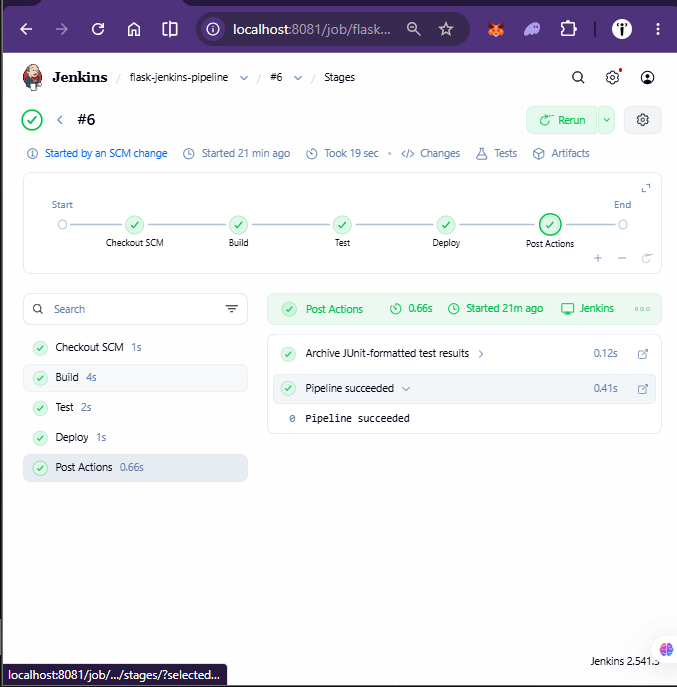
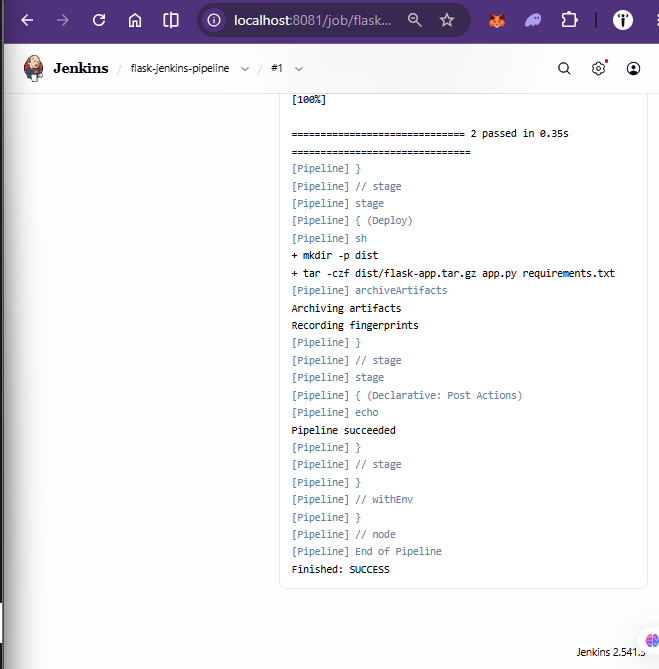
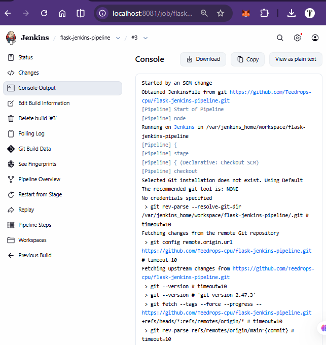
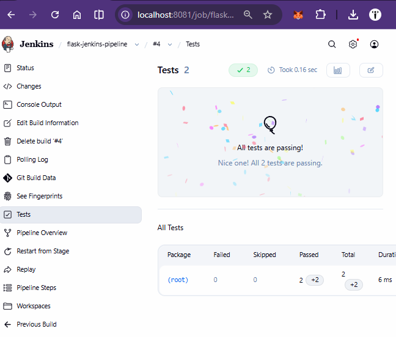
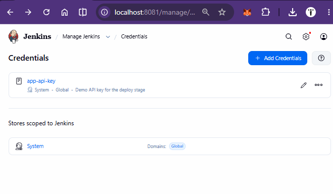
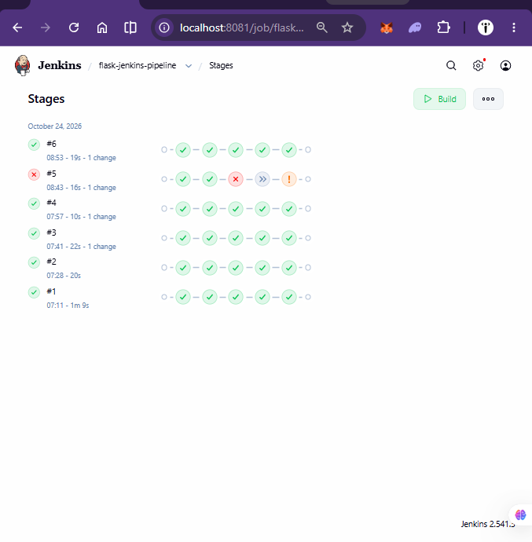

# flask-jenkins-pipeline

A small Flask app with a jenkins CI/CD pipeline (Build, Test, Deploy).

## Additional evidence

**Stage names, build #6:** Build, Test and Deploy all green.

**First successful run (build #1):**

**Automatic trigger:** build #3 shows `Started by an SCM change`, so no manual click was needed.

**Test report from the JUnit plugin:**

**Credential stored in Jenkins (the secret value is never shown):**

**Build history stage by stage:** #5 is the deliberate failure, where Test failed and Deploy was skipped.

